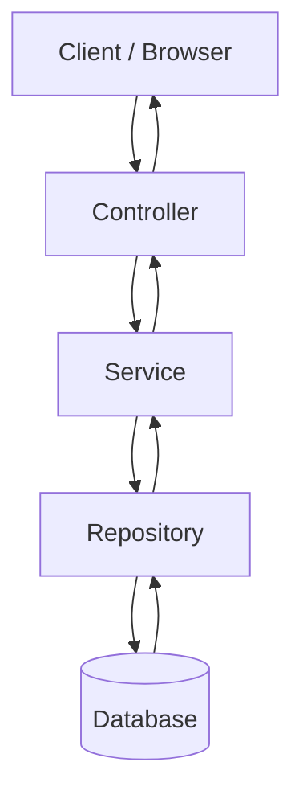

# Spring Boot Project Structure

Understanding the standard Maven folder structure of a Spring Boot application.

## 1. General Project Structure

```text
practiceAfroze/
│
├── src/
│   │
│   ├── main/
│   │   │
│   │   ├── java/
│   │   │   └── com/example/practiceAfroze/
│   │   │       │
│   │   │       ├── PracticeAfrozeApplication.java
│   │   │       │
│   │   │       ├── controllers/
│   │   │       ├── services/
│   │   │       ├── repositories/
│   │   │       ├── models/
│   │   │       └── config/
│   │   │
│   │   └── resources/
│   │       │
│   │       ├── application.properties
│   │       ├── static/
│   │       ├── templates/
│   │       └── ...
│   │
│   └── test/
│       │
│       ├── java/
│       │   └── com/example/practiceAfroze/
│       │       └── PracticeAfrozeApplicationTests.java
│       │
│       └── resources/
│
├── target/
│
├── pom.xml
└── README.md
```

## 2. Understanding the Folder Structure

### A. `src/main/java`

Contains the actual Java application source code.

| Folder / File | Responsibility |
|---|---|
| `PracticeAfrozeApplication.java` | Main entry point of the Spring Boot application |
| `controllers/` | Handles incoming HTTP requests |
| `services/` | Contains business logic |
| `repositories/` | Handles database operations |
| `models/` | Contains application models and entities |
| `config/` | Contains application configuration classes |

### B. `src/main/resources`

Contains application configuration and supporting resources.

| File / Folder | Responsibility |
|---|---|
| `application.properties` | Application configuration |
| `static/` | Static files such as CSS, JavaScript and images |
| `templates/` | Server-side HTML templates |
| Other resources | Additional configuration and supporting files |

### C. `src/test/java`

Contains Java test source code.

Examples:

- Unit tests
- Integration tests
- Controller tests
- Service tests

### D. `src/test/resources`

Contains resources required specifically for testing.

Examples:

- Test configuration
- Test data
- SQL scripts

## 3. Understanding the `target/` Folder

`target/` is a Maven-generated folder.

When we execute:

```bash
mvn clean package
```

Maven performs the following operations:

1. Cleans previous build output.
2. Compiles application source code.
3. Compiles test source code.
4. Runs tests.
5. Packages the application into a JAR or WAR.
6. Stores generated build output inside `target/`.

**Important:** We generally don't manually write application source code inside `target/`.

## 4. Understanding `pom.xml`

`pom.xml` stands for Project Object Model.

It is the configuration file used by Maven to manage the Java project.

It defines:

- Project information
- Java version
- Spring Boot version
- Dependencies
- Build plugins

Example:

```xml
<dependencies>
    <dependency>
        <groupId>org.springframework.boot</groupId>
        <artifactId>spring-boot-starter-web</artifactId>
    </dependency>
</dependencies>
```

This dependency adds Spring Boot Web functionality to the project.

## 5. Understanding the Application Flow



This represents a typical layered Spring Boot application request flow.

## 6. Quick Revision

| Folder / File | Purpose |
|---|---|
| `src/main/java` | Application Java code |
| `src/main/resources` | Configuration and resources |
| `src/test/java` | Java test code |
| `src/test/resources` | Test resources |
| `target/` | Generated build output |
| `pom.xml` | Maven configuration |
| `README.md` | Project documentation |

## 7. Remember

- **main** = Code required to run the application.
- **test** = Code required to test the application.
- **resources** = Supporting files and configurations.
- **target** = Generated build output.
- **pom.xml** = Maven project configuration.

This is the standard Maven directory layout followed by Spring Boot applications.
