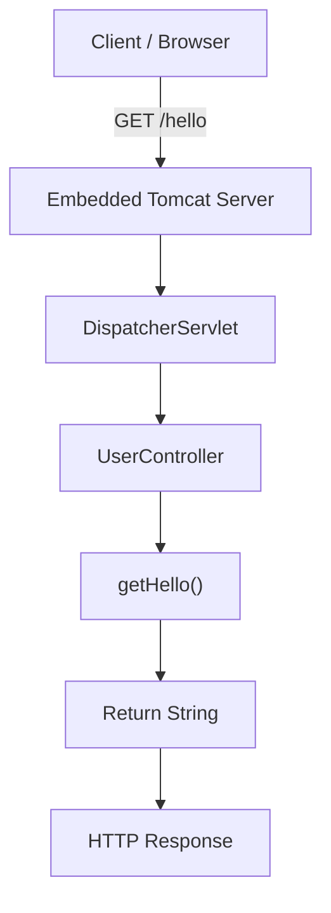

# Spring Boot – Creating a Simple Controller

## 1. Project Setup

Create a Spring Boot project using [Spring Initializr](https://start.spring.io/).

**Project configuration:**

| Setting | Value |
|---|---|
| Project | Maven |
| Language | Java |
| Packaging | Jar |
| Java | 21 (or your installed compatible version) |
| Group | `com.example` |
| Artifact | `demo` |

**Dependencies:**
- Spring Web

Click **Generate**, extract the downloaded ZIP file, and open the project in your IDE.

## 2. Project Structure

```text
demo/
│
├── src/
│   └── main/
│       ├── java/
│       │   └── com/example/demo/
│       │       ├── DemoApplication.java
│       │       └── controller/
│       │           └── UserController.java
│       │
│       └── resources/
│           └── application.properties
│
└── pom.xml
```

## 3. Main Application Class

**DemoApplication.java**

```java
package com.example.demo;

import org.springframework.boot.SpringApplication;
import org.springframework.boot.autoconfigure.SpringBootApplication;

@SpringBootApplication
public class DemoApplication {

    public static void main(String[] args) {

        SpringApplication.run(DemoApplication.class, args);

    }
}
```

### Understanding the annotations and methods

| Component | Purpose |
|---|---|
| `@SpringBootApplication` | Marks the main Spring Boot configuration class and enables auto-configuration and component scanning. |
| `main()` | Entry point of the Java application. |
| `SpringApplication.run()` | Starts the Spring Boot application and its embedded server. |

## 4. Creating a Simple Controller

Create a package named `controller` and add `UserController.java`.

```java
package com.example.demo.controller;

import org.springframework.web.bind.annotation.GetMapping;
import org.springframework.web.bind.annotation.RestController;

@RestController
public class UserController {

    @GetMapping("/hello")
    public String getHello() {

        return "Hello from Spring Boot!";

    }

    @GetMapping("/user")
    public String getUser() {

        return "Welcome to the User API!";

    }
}
```

### Understanding the annotations

**1. `@RestController`**

- Marks the class as a REST controller.
- Tells Spring that the methods return response data directly.
- Spring converts returned objects into HTTP responses (strings are returned as text).

**2. `@GetMapping`**

- Maps HTTP GET requests to a particular method.
- Used to expose an endpoint that clients can access through a URL.

Example:

```java
@GetMapping("/hello")
```

When a client sends a GET request to `/hello`, Spring executes `getHello()`.

**3. Return statement**

```java
return "Hello from Spring Boot!";
```

The returned string becomes the HTTP response body.

## 5. application.properties

Location:

```text
src/main/resources/application.properties
```

Add:

```properties
server.port=8080
```

This configures the embedded server to run on port `8080`.

If you don't specify a port, Spring Boot uses `8080` by default.

## 6. Run the Application

Run the `main()` method inside `DemoApplication.java`.

Spring Boot starts its embedded Tomcat server (when using the default Spring MVC web starter).

You should see a startup message indicating that Tomcat is running on port 8080.

## 7. Test the GET Endpoints

You can test these endpoints directly in your browser.

| HTTP Method | URL | Expected Response |
|---|---|---|
| GET | `http://localhost:8080/hello` | Hello from Spring Boot! |
| GET | `http://localhost:8080/user` | Welcome to the User API! |

You can also test them using Postman or curl.

**Using Terminal:**

```bash
curl http://localhost:8080/hello
```

```bash
curl http://localhost:8080/user
```

## 8. How Does the Request Work?



### Request flow

1. The client sends an HTTP GET request.
2. Embedded Tomcat receives the request.
3. Spring MVC's `DispatcherServlet` handles request routing.
4. Spring identifies the matching `@GetMapping`.
5. The corresponding controller method executes.
6. The returned value becomes the HTTP response.

## 9. Important Things to Remember

| Concept | Meaning |
|---|---|
| Controller | Handles incoming HTTP requests. |
| `@RestController` | Defines a REST controller. |
| `@GetMapping` | Handles HTTP GET requests. |
| Endpoint | URL exposed by the application. |
| Tomcat | Embedded web server. |
| DispatcherServlet | Front controller that dispatches incoming requests. |
| Port 8080 | Default Spring Boot web server port. |

**Key takeaway:** A simple Spring Boot controller can expose HTTP endpoints without requiring Service or Repository layers. The controller receives requests, executes its methods, and returns responses directly.
